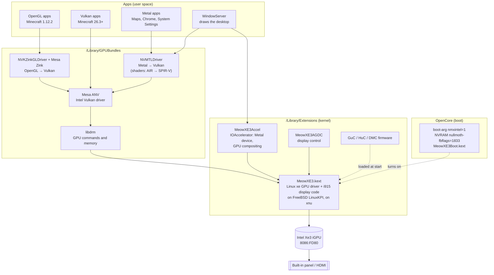

# MeowXE3
A Custom Vulkan to Metal DriverStack for Graphics Acceleration of Intel XE3 PantherLake / WildCat Lake Systems.

> [!NOTE]
> This kext is not guaranteed to always work and is in **ALPHA** stages. Still currently in Development.

> [!WARNING]
> **MeowXE3** is not responsible for any damages caused by using this driver on your machine. You are taking full responsibility for using **ALPHA** software.

```
        /\_/\      Metal  *  Vulkan  *  OpenGL (Zink)  *  GPU compositing  *  brightness
       ( o.o )     on the Intel Xe3 iGPU, macOS Tahoe 26, OpenCore
        > ^ <
```

## What works and what doesn't

| Feature | Status | Notes |
|---|:---:|---|
| Graphics acceleration (GPU compositing) | ✅ Works | WindowServer draws on the GPU; smooth animations |
| Tear-free display | ✅ Works | page flips on the built-in panel |
| Metal | ✅ Works | Metal 3; shown in System Information |
| Vulkan | ✅ Works | native Intel driver for apps (Minecraft 26.3+ at 60 fps) |
| OpenGL | ✅ Works | through Mesa Zink (Minecraft 1.12.2 at ~30 fps) |
| WebGL in Chrome / Chromium browsers | ✅ Works | |
| Dock badges, login picture, Dock blur | ✅ Works | |
| Brightness slider | ✅ Works | |
| Brightness keys | ✅ Works | X1504MA needs two DSDT edits: [guide](docs/X1504MA-brightness-keys.md) |
| Shutdown / restart | ✅ Works | |
| Wi-Fi |  ✅ Works | changed for a Intel Wi-Fi Card |
| HDMI display | ⚠️ Partly | works only if the monitor is connected **when the Mac boots**; plugging it in later doesn't. Same image as the built-in panel (no extended desktop). **No HDMI audio** |
| USB-C / DisplayPort display | ⚠️ Untested | |
| Panther Lake, Wildcat Lake `FD81` | ⚠️ Untested | in the driver, never run on real hardware |
| Sleep | ❌ Doesn't work | the firmware's sleep fails; sleep is turned off |
| Internal speakers / headphone jack | ❌ Doesn't work | the Realtek codec is on SoundWire, which needs Intel's DSP firmware. USB or Bluetooth audio should work instead (untested) |
| Camera | ⚠️ Partly | the camera itself works: browsers (Chrome, web video calls) show it. Apple's own apps (Photo Booth, FaceTime) show a **black preview**, a drawing problem in the Metal driver, not the camera |
| Safari WebGL / YouTube | ❌ Doesn't work | Safari's sandbox blocks the driver; YouTube also needs an audio output (USB or Bluetooth, untested) |

Details and what has been tried: [docs/FINDINGS.md](docs/FINDINGS.md).

> [!CAUTION]
> **Photo Booth / FaceTime:** besides the black preview, leaving Photo Booth open for a few minutes has caused a kernel
> panic. Use the camera from a browser for now, and avoid Apple's camera apps until this is fixed.

**Tested on:** ASUS Vivobook X1504MA, Intel Wildcat Lake `8086:FD80`, macOS Tahoe 26.7, OpenCore 1.0.8.

**macOS Sequoia (15.5 or newer):** a separate `MeowXE3-<version>-sequoia.zip` build, **untested on hardware**. Only the
accelerator kext differs from the Tahoe build; see [docs/SEQUOIA.md](docs/SEQUOIA.md).

**In the driver but never run on real hardware:** Wildcat Lake `FD81`, and Panther Lake `B080`–`B087`, `B08F`, `B090`–`B092`,
`B0A0`–`B0A2`, `B0B0`. They use the same firmware family and display generation, so they have a fair chance, but expect
problems. The installer warns you, and reports from these machines are very welcome.

**External displays:** HDMI works if the monitor is plugged in when the Mac boots (tested): the driver lights every
connected output with the same image as the built-in panel. Plugging a monitor in after boot doesn't bring it up, there is
no extended desktop yet, and there is no HDMI audio. USB-C / DisplayPort outputs are untested.

## How it works



- **Apps** use Metal, Vulkan or OpenGL as on any Mac.
- **Metal** calls go to `NVMTLDriver`, which turns them into Vulkan calls. Shaders are translated from Apple's AIR to
  SPIR-V.
- **OpenGL** goes through Mesa's Zink, which also runs on Vulkan.
- **Vulkan** calls land in Mesa's Intel driver (ANV), which talks to the kernel through `libdrm`.
- **In the kernel,** `MeowXE3.kext` is Linux's `xe` GPU driver and Intel's display code. They run on FreeBSD's Linux
  compatibility layer, ported to the macOS kernel (NullMoth's NMXGPU). It loads the GPU firmware, runs the GPU and
  drives the panel.
- **`MeowXE3Accel`** is the accelerator macOS looks for. It gives apps a Metal device and lets WindowServer composite
  the desktop on the GPU and flip finished frames onto the screen.
- **OpenCore** turns the driver on at boot (`nmxintel=1`) and picks the display mode (`nullmoth-fbflags`).

## Install

1. Download `MeowXE3-<version>.zip` (Tahoe) or `MeowXE3-<version>-sequoia.zip` (Sequoia 15.5+) from [Releases](../../releases) and unzip it.
2. Right-click **`Install MeowXE3.command`** > **Open** (macOS blocks a plain double-click on downloaded scripts),
   or in Terminal: `sudo bash ~/Downloads/MeowXE3-<version>/Install\ MeowXE3.command`
3. Choose **[1] install everything**, approve MeowXE3 in System Settings > Privacy & Security if asked, restart.

Try `--dry-run` first: it checks your Mac and prints the exact OpenCore changes on a copy, without changing anything.

### What the installer changes

**macOS:**
- `/Library/Extensions`: `MeowXE3.kext`, `MeowXE3Accel.kext`, `MeowXE3AGDC.kext`
- `/Library/GPUBundles`: the Metal driver, Vulkan, Zink
- `/Library/NullMoth/firmware`: Intel GuC/HuC/DMC firmware
- The auxiliary kext collection is rebuilt.

**OpenCore** (only after you say yes; a full copy of your `EFI` folder is saved in your home folder first):
- `Kexts/MeowXE3Boot.kext` plus a Kernel > Add entry. Without it the Mac can't fully sleep with the driver on.
- boot-args `nmxintel=1`. This is the on switch.
- NVRAM `nullmoth-fbflags` = `1833`: GPU compositing and page flips.
- `Tools/NullMothSafe.efi`, shown in the boot picker as **"MeowXE3: start once without driver"**.

It does **not** touch SIP, AMFI, ACPI/DSDT, SMBIOS or your other kexts. Every edit is checked with `plutil -lint`
before it is written.

### What you must set yourself

The installer checks these and tells you if they are missing, but leaves the decision to you:

- **SIP:** third-party kext loading allowed (Kext Signing disabled), e.g. `csr-active-config` = `030A0000`.
  MeowXE3's kexts are ad-hoc signed.
- **AMFI:** boot-args `amfi_get_out_of_my_way=0x1 amfi=0x80 ipc_control_port_options=0`. Apps load the Metal driver
  from `/Library/GPUBundles`, which is not Apple-signed. This lowers macOS security; understand that before you add it.

### If something goes wrong

- **Black screen or hang at boot:** in the OpenCore picker, choose **"MeowXE3: start once without driver"**, then
  pick macOS. That boot runs without MeowXE3.
- **Off for good:** run the installer > **[4] uninstall**, or remove `nmxintel=1` from boot-args.
- **Your old EFI:** it was saved to `~/MeowXE3-EFI-backup-<date>/EFI`. Copy it back to the EFI partition.
- **Log:** `/Users/Shared/MeowXE3-install.log`

## Minecraft / Java on Vulkan

LWJGL ships MoltenVK. To use MeowXE3's Vulkan driver instead, add this JVM argument (in Prism Launcher: Settings >
Java > JVM arguments):

```
-Dorg.lwjgl.vulkan.libname=/Library/GPUBundles/nvmtl/libvulkan.1.dylib
```

Then pick Vulkan in Minecraft 26.3+ Video Settings. Older OpenGL versions run through Zink automatically.

## More apps on Metal

Every app is allowed by default (`*` in `/Library/GPUBundles/nvmtl-allow.txt`). To manage the list:
`sudo bash /Library/GPUBundles/MeowXE3/allow-app.sh NAME` (`-r NAME` removes).

## Repository layout

| Path | What |
|---|---|
| `Install MeowXE3.command` | the installer (needs the release zip's `payload/` next to it) |
| `tools/oc-patch.sh` | OpenCore config edits, using Apple's PlistBuddy (`apply` / `remove` / `check`) |
| `tools/install-meowxe3.sh` | the driver part of the install |
| `tools/dev/` | `make-release.sh` (builds the release zip) and `repack.sh` (renames the NullMoth build outputs to MeowXE3) |
| `patches/nmxgpu/` | kernel driver patches for Wildcat Lake on NullMoth's NMXGPU (xe + i915 display on LinuxKPI) |
| `patches/nvidia-macos-driver/` | NMXAccel and Metal plugin patches |
| `patches/mesa/` | Mesa ANV patches (macOS Metal window surfaces) |
| `patches/zink/` | Zink on Intel: `0001` on Mesa 26.3.0 @0a6fa60 after HighDelay's `prepare_zink.py`, `0002` on HighDelay's CGL/GLD bridge |
| `tools/build/` | build and install scripts for Mesa ANV, Zink, the translator and the Metal plugin (expect sources under `$NMX`, default `~/nmx`) |
| `tools/tests/` | Metal regression tests (compute, render, mipmapped buffer textures) |
| `tools/com.meowxe3.java-vulkan.plist` | optional LaunchAgent: every Java program uses MeowXE3's Vulkan driver |
| `src/MeowXE3Boot/` | the small OpenCore-injected kext |
| `docs/` | [continuing the work](docs/CONTINUING.md) (sources, pins, rebuilding, open threads), [findings and open problems](docs/FINDINGS.md), [X1504MA brightness keys](docs/X1504MA-brightness-keys.md) |
| `patches/base/`, `patches/experimental/` | NullMoth's Mesa/libdrm base patches; unreleased work (camera) |
| `EFI-X1504MA/` | the OpenCore EFI this was developed on (serials removed), as a reference |

The binaries (about 340 MB, including LLVM) are in the release zip, not in git.

## Credits

MeowXE3 stands on other people's work. Thank you to:

### The driver

| Who | What MeowXE3 uses |
|---|---|
| [**NullMoth**](https://github.com/nullmoth) ([nvidia-macos-driver](https://github.com/nullmoth/nvidia-macos-driver)) | the foundation. NMXGPU (Linux's `xe` driver on a FreeBSD LinuxKPI port to the macOS kernel), the NMXAccel accelerator, the NVMTL Metal-to-Vulkan driver and shader translator, NMXAudio, and the "start once without driver" boot tool. MeowXE3 is a renamed, modified build of it |
| [**ericek111**](https://github.com/ericek111) ([vibe-nullmoth-xe3-qemu](https://github.com/ericek111/vibe-nullmoth-xe3-qemu)) | the Intel Xe3 groundwork: the xkpi, drm-kmod, Mesa (ANV on macOS), libdrm and plugin patch series, NMXAGDC, and the shader translator fixes MeowXE3 builds on |
| [**HighDelay**](https://github.com/HighDelay) ([nvidia-macos-driver-nvk](https://github.com/HighDelay/nvidia-macos-driver-nvk)) | OpenGL through Zink: the pinned Zink setup (`prepare_zink.py`) and the CGL/GLD bridge that MeowXE3's Zink runs on |
| [**watchthelight**](https://github.com/watchthelight) | NullMoth plugin fixes ported here: heap texture swizzles (yellow icons on Intel), buffer memory types, and the restored Dock blur sampler |
| [**daggersinmybackk**](https://github.com/daggersinmybackk) | the drawable usage fix that lets Core Image render into window textures (NullMoth #433) |
| modest-tao | NullMoth's storage-twin writes and one-image-per-IOSurface work, which the camera work builds on |

### Upstream projects

| Project | Used for |
|---|---|
| [Linux](https://github.com/torvalds/linux) (Intel `xe` and display code) | the GPU and display driver itself |
| [FreeBSD](https://github.com/freebsd/freebsd-src) and [drm-kmod](https://github.com/freebsd/drm-kmod) | LinuxKPI, the DRM core, and the HD Audio driver |
| [Mesa](https://gitlab.freedesktop.org/mesa/mesa) | ANV (Intel Vulkan) and Zink (OpenGL on Vulkan) |
| [libdrm](https://gitlab.freedesktop.org/mesa/drm) | the userspace side of the GPU driver |
| [LLVM](https://github.com/llvm/llvm-project) and [zstd](https://github.com/facebook/zstd) | shader compilation and compression in the Metal driver |
| [Intel linux-firmware](https://gitlab.com/kernel-firmware/linux-firmware) | the GuC, HuC and DMC firmware |

### The OpenCore setup (EFI-X1504MA)

| Who | What |
|---|---|
| [**acidanthera**](https://github.com/acidanthera) | [OpenCore](https://github.com/acidanthera/OpenCorePkg), [Lilu](https://github.com/acidanthera/Lilu), [VirtualSMC](https://github.com/acidanthera/VirtualSMC), [VoodooPS2](https://github.com/acidanthera/VoodooPS2), [NVMeFix](https://github.com/acidanthera/NVMeFix), [RestrictEvents](https://github.com/acidanthera/RestrictEvents), [BrightnessKeys](https://github.com/acidanthera/BrightnessKeys), BlueToolFixup ([BrcmPatchRAM](https://github.com/acidanthera/BrcmPatchRAM)) |
| [**OpenIntelWireless**](https://github.com/OpenIntelWireless) | [AirportItlwm](https://github.com/OpenIntelWireless/itlwm) (Wi-Fi), [IntelBluetoothFirmware](https://github.com/OpenIntelWireless/IntelBluetoothFirmware) |
| [**VoodooI2C**](https://github.com/VoodooI2C) | [VoodooI2C](https://github.com/VoodooI2C/VoodooI2C) (trackpad) |
| [**dhinakg**](https://github.com/dhinakg) | [USBToolBox](https://github.com/USBToolBox/kext), AMFIPass |
| [**averycblack**](https://github.com/averycblack) | [ECEnabler](https://github.com/averycblack/ECEnabler) (battery readings) |
| [**corpnewt**](https://github.com/corpnewt) | [GenSMBIOS](https://github.com/corpnewt/GenSMBIOS), for making your own serials |

## License

MeowXE3 is a renamed, modified build of [NullMoth](https://github.com/nullmoth/nvidia-macos-driver), with patches by
[ericek111](https://github.com/ericek111) and the MeowXE3 patches in this repository. It is under the **PolyForm
Noncommercial 1.0.0** license (`LICENSE-NullMoth.md`): **noncommercial use only**, and keep the notice.

Required Notice: Copyright (c) 2026 NullMoth Systems (https://nullmothsystems.com)

These parts keep their own licenses: Mesa (MIT), libdrm (MIT), the Linux xe/i915 code (MIT/GPL-2.0, as marked in each
file), LLVM (Apache-2.0 with LLVM exception), zstd (BSD), and Intel's linux-firmware blobs (redistribution allowed
under Intel's license). See `NOTICE.md`. The OpenCore kexts keep their authors' licenses.
